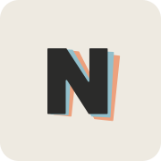

<div align="center">
  
  <h1>Notedd</h1>
  <p>Небольшое окно для заметок, которое всегда под рукой.</p>
  <p><a href="README.md">English</a> · <b>Русский</b></p>
  <p><a href="https://github.com/TheKucel/Notedd/releases">Скачать</a> · <a href="#горячие-клавиши">Горячие клавиши</a> · <a href="#сборка-из-исходного-кода">Сборка из исходного кода</a></p>
</div>

---

Notedd — небольшое окно для заметок, которое можно открыть поверх других дел. Нажмите `Ctrl+Alt+Space`, запишите мысль и нажмите сочетание ещё раз, чтобы скрыть окно.

`Ctrl+P` открывает стопку заметок. Перемещайтесь по ней колёсиком мыши или клавишами со стрелками. Начните печатать, чтобы искать по всем заметкам; если ничего не найдено, нажмите Enter, чтобы создать заметку с введённым текстом. `Ctrl+F` ищет внутри открытой заметки.

## Windows

Notedd работает на Windows 10 и 11 (x64). Скачайте и запустите `notedd-setup.exe` со страницы [релизов](https://github.com/TheKucel/Notedd/releases).

По умолчанию установщик помещает приложение в `%LOCALAPPDATA%\Programs\Notedd`. При установке можно выбрать режим редактора, папку для заметок и запуск вместе с Windows. Права администратора не нужны. Приложение не подписано, поэтому Windows может показать предупреждение.

Чтобы удалить приложение, откройте **Параметры → Приложения** в Windows или запустите `.\uninstall.exe --uninstall` из папки установки. Заметки останутся на месте.

## macOS

Распакуйте `notedd-macos.zip` и переместите `Notedd.app` в папку «Программы». Нужна macOS 13 или новее; поддерживаются компьютеры с Apple Silicon и Intel. У приложения временная подпись и нет нотариального заверения Apple, поэтому при первом запуске нажмите на него правой кнопкой мыши и выберите **Открыть**.

Notedd находится в строке меню и не показывает значок в Dock. В сочетаниях клавиш внутри приложения вместо `Ctrl` используется `Command`. Настройки хранятся в `~/Library/Application Support/Notedd/settings.txt`.

## Linux

Распакуйте `notedd-linux-x86_64.tar.gz` и запустите `notedd`. Приложению нужен X-сервер: в окружении Wayland оно запускается через XWayland, чтобы перемещать и прикреплять окно. Для запуска непосредственно в Wayland задайте `NOTEDD_WAYLAND=1`; в этом режиме положение окна определяет рабочий стол. Для значка в трее нужна поддержка AppIndicator. Настройки хранятся в `~/.config/Notedd/settings.txt`.

## Горячие клавиши

Сочетания ниже относятся к Windows и Linux. В macOS внутри приложения вместо `Ctrl` используется `Command`.

| Клавиши | Действие |
| --- | --- |
| `Ctrl+Alt+Space` | Показать или скрыть Notedd из любого приложения |
| `Ctrl+Alt+N` | Создать заметку из любого приложения |
| `Ctrl+N` | Создать заметку |
| `Ctrl+P` | Открыть стопку заметок |
| `Ctrl+F` | Найти текст в текущей заметке |
| `Ctrl+T` | Закрепить окно поверх остальных |
| `Ctrl+Shift+C` | Изменить цвет заметки |
| `Ctrl+Shift+H` | Выделить выбранный текст цветом или убрать выделение |
| `Ctrl+Shift+Delete` или `Delete` в стопке | Удалить заметку |
| `Ctrl+Z` в стопке | Вернуть последнюю удалённую заметку |
| `Ctrl+,` | Открыть настройки |
| `Ctrl+Q` | Выйти |
| `Esc` | Вернуться назад или скрыть редактор |
| `Ctrl+=`, `Ctrl+-` или `Ctrl+колесо мыши` | Изменить размер текста; `Ctrl+0` возвращает исходный размер |

Сочетания можно изменить в разделе **Настройки → Горячие клавиши**. Там же доступны темы и выбор языка: английский, русский или упрощённый китайский.

## Заметки и редактор

Каждая заметка — это Markdown-файл, первая строка которого становится заголовком. По умолчанию заметки хранятся в `Documents/Notedd`; папку можно изменить в настройках. В Windows настройки приложения находятся в `%APPDATA%\Notedd\settings.txt`.

Заголовки, списки, цитаты, код, ссылки и флажки отображаются по мере ввода. Чтобы отметить флажок, нажмите на него или используйте `Ctrl+Enter`. Ссылка открывается по `Ctrl+клику`.

Чтобы выделить текст цветом, используйте `==текст==` или выделите его и нажмите `Ctrl+Shift+H`.

В разделе **Настройки → Общие → Редактор** выберите **Markdown**, чтобы видеть разметку, или **Simple**, чтобы скрывать её во время письма. В режиме Simple выделите текст и нажмите правую кнопку мыши для форматирования. `Ctrl+B` включает жирный шрифт, `Ctrl+I` — курсив, `Ctrl+Shift+S` — зачёркивание, а `Ctrl+E` — встроенный код. Оба режима сохраняют одни и те же Markdown-файлы.

В заметку можно вставить снимок экрана или перетащить изображение. Notedd сохранит его в папке `assets` рядом с заметками и добавит относительную Markdown-ссылку. Цвета заметок хранятся в YAML-метаданных.

Удалённые заметки по возможности отправляются в корзину. Если это не удаётся, Notedd удаляет файл напрямую.

## Сборка из исходного кода

Notedd написан на Rust с использованием [GPUI](https://www.gpui.rs/); локальные изменения зависимостей находятся в `app/vendor` (см. [PATCHES.md](app/vendor/PATCHES.md)). Модель редактора находится в `editor`, обработка Markdown и хранение заметок — в `core`.

**Windows.** Установите Rust с набором инструментов MSVC. Для добавления значка и информации о версии сборка использует `rc.exe` из Windows SDK. Установщик включает `notedd.exe`, поэтому сначала соберите приложение:

```powershell
cargo build --release --locked --manifest-path app/Cargo.toml
cargo build --release --locked --manifest-path setup/Cargo.toml
```

Установщик появится в `setup/target/release/notedd-setup.exe`.

**macOS.** Установите Xcode или его Command Line Tools, выполните `rustup target add aarch64-apple-darwin x86_64-apple-darwin`, затем `./app/macos/bundle.sh`. В `app/target/macos` появятся `Notedd.app` и `notedd-macos.zip`.

**Linux.** Установите пакеты разработки X11, Wayland, xkbcommon, fontconfig, GTK 3 и AppIndicator (список находится в [build.yml](.github/workflows/build.yml)), затем выполните:

```bash
cargo build --release --locked --manifest-path app/Cargo.toml
```

## Лицензия

Код распространяется по [лицензии MIT](LICENSE). Шрифт Geologica включён на условиях [SIL Open Font License 1.1](assets/fonts/OFL-Geologica.txt).
